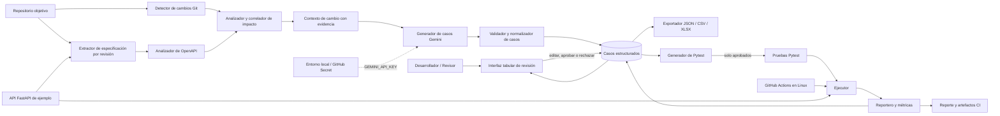

# 02. Arquitectura

## 1. Objetivo y principios

La arquitectura separa la detección de cambios, el análisis del contrato, la generación asistida, la decisión humana, la generación de pruebas y su ejecución. Las propuestas del LLM son datos no confiables: no se convierten en código ejecutable ni adquieren un estado de aprobación sin intervención del desarrollador.

Principios:

- Evidencia y trazabilidad desde cada cambio hasta el resultado de la prueba.
- Contrato OpenAPI y diffs como contexto verificable; toda heurística se identifica como tal.
- Persistencia de casos estructurados y decisiones humanas entre sesiones.
- Clave Gemini fuera del código, los casos y los artefactos.
- Módulos ejecutables localmente en Windows y en CI sobre Linux.
- Sin dependencia del repositorio ni del código de DeltaHeal.

## 2. Diagrama de componentes



La vista es lógica; la primera implementación puede ejecutarse como una aplicación local de un solo proceso. La interfaz web, el almacenamiento y la lógica de dominio se mantendrán separados para que las pruebas no dependan del navegador.

## 3. Módulos y responsabilidades

### 3.1 Detector de cambios Git

Recibe las referencias base y destino, obtiene el diff y enumera archivos modificados, añadidos, eliminados y renombrados. Cada hallazgo conserva la ruta, el tipo de cambio y la referencia de origen. Debe informar errores de referencias faltantes, repositorios inválidos y diffs inaccesibles.

### 3.2 Extractor y analizador OpenAPI

Obtiene la especificación correspondiente a cada revisión Git cuando el archivo está versionado y la interpreta. Identifica operaciones por método HTTP y ruta, `operationId`, parámetros, esquemas y respuestas; calcula qué elementos cambiaron, se añadieron o eliminaron. Si la especificación solo está disponible en una revisión, lo informa y no simula un diff completo.

### 3.3 Analizador y correlador de impacto

Combina dos fuentes distintas:

1. **Diff de código:** archivos y fragmentos/símbolos afectados aportan evidencia de implementación.
2. **Diff OpenAPI:** operaciones y restricciones alteradas aportan evidencia de contrato observable.

El analizador relaciona los hallazgos mediante rutas y nombres de módulos, `operationId`, referencias a esquemas, convenciones del proyecto y asociaciones configurables. Presenta las correspondencias como:

- **Concordante:** hay evidencia relacionada en ambas fuentes; se prioriza como candidato de impacto.
- **Solo código** o **solo OpenAPI:** una fuente muestra cambios y la otra no permite corroborarlos; se conserva como candidato con incertidumbre explícita.
- **Sin relación demostrable:** se informa el hallazgo de origen sin adjudicarlo a una operación concreta.

La presencia de evidencia en ambas fuentes incrementa la prioridad, pero no demuestra por sí misma que exista un defecto. La ausencia de una especificación en una revisión, los cambios globales y las asociaciones heurísticas se reportan como limitaciones.

### 3.4 Generador de casos con LLM

Construye una solicitud acotada con los impactos candidatos, las partes pertinentes del contrato y el formato requerido. Usa Gemini con `GEMINI_MODEL` (predeterminado `gemini-3.8-flash`) y obtiene la credencial de `GEMINI_API_KEY`. Valida la respuesta contra el esquema interno, registra modelo y metadatos no sensibles disponibles y presenta errores de configuración, cuota o salida inválida de manera explícita.

El generador propone escenarios y resultados esperados a partir de la evidencia; no declara que los casos sean correctos, aprobados o ejecutados. Nunca establece el resultado observado de una prueba.

### 3.5 Almacenamiento y validador de casos

Mantiene la representación canónica estructurada de los casos, sus IDs, fuente, impacto, decisión de revisión, asociación a un archivo de prueba y resultado de ejecución. Valida campos obligatorios y valores permitidos antes de guardar o exportar. La decisión humana y el estado de ejecución son campos independientes.

### 3.6 Revisor humano

Una interfaz web local presenta la tabla editable agrupada por RF y permite aprobar o rechazar cada propuesta. Las modificaciones no cambian de manera implícita el historial de ejecución. El revisor puede filtrar, consultar evidencia del impacto, corregir los datos HTTP y exportar el conjunto revisado.

### 3.7 Exportador

Genera:

- **JSON** como formato de intercambio canónico, que conserva campos anidados, decisiones, trazabilidad y metadatos.
- **CSV** para interoperabilidad tabular; se aplana la estructura y se documenta el esquema de columnas.
- **XLSX** editable y agrupado por RF, siguiendo el estilo del catálogo, con hoja de casos, métricas por RF y resumen por módulo.

En cada hoja de casos, las columnas aparecen en este orden: `ID`, `Técnica`, `Descripción del Caso`, `Precondiciones`, `Datos de Entrada`, `Pasos`, `Resultado Esperado`, `Estado`, `Automatizado`, y luego `Método HTTP`, `Endpoint`, `Parámetros`, `Cuerpo`, `Código de respuesta esperado`. La decisión de revisión, el vínculo a Pytest y la evidencia se conservan como metadatos adicionales sin desplazar las columnas obligatorias.

Las métricas por RF incluyen total de casos, distribución por técnica, estados (Exitoso, Fallido y No ejecutado), y porcentaje de aprobación sobre casos revisados. La hoja resumen por módulo presenta `#Casos`, `Exitoso`, `Fallido` y `Automatizado`. Un caso no ejecutado no se cuenta como exitoso ni fallido.

### 3.8 Generador de Pytest

Transforma exclusivamente casos cuya decisión humana sea **Aprobado** y que satisfagan el contrato interno de generación. Cada prueba incorpora el ID del caso y el RF para permitir rastrear su resultado. Las pruebas se escriben en un espacio designado y el código generado puede inspeccionarse antes de ejecutarse. Casos pendientes y rechazados no se convierten en pruebas.

### 3.9 Ejecutor y reportero

El ejecutor invoca Pytest en el entorno configurado, captura el código de salida, la salida de pruebas y los resultados por caso. El reportero actualiza `Estado` únicamente con evidencia real: **Exitoso** si la prueba asociada pasó, **Fallido** si falló y **No ejecutado** si no se ejecutó. Los errores de infraestructura se reportan por separado y nunca se convierten en éxito.

El reportero agrega resultados por RF y módulo, calcula métricas de evaluación cuando dispone de sus denominadores y produce archivos legibles y artefactos para CI.

### 3.10 Integración continua

GitHub Actions ejecuta validaciones y pruebas en un runner Linux ante `push` y `pull_request`. La ejecución CI usa los casos y pruebas aprobados ya disponibles; una clave Gemini no es necesaria para probarlos. Si en el futuro se añade generación durante CI, debe ser un paso explícito, protegido y no debe exponer secretos a código no confiable de Pull Requests.

### 3.11 API de ejemplo

`examples/` alojará una API FastAPI pequeña y autocontenida. FastAPI ofrece una especificación OpenAPI local, lo cual permite validar la extracción del contrato, operaciones CRUD, datos válidos e inválidos y casos límite sin depender de un servicio externo.

## 4. Flujo de datos

1. El usuario selecciona la revisión base y la de destino, o el evento Git proporciona ese par.
2. El detector obtiene el diff de código y el extractor obtiene las especificaciones OpenAPI de ambas revisiones.
3. El analizador compara las especificaciones; el correlador combina los cambios de código y contrato, adjuntando evidencia y limitaciones.
4. El generador construye casos candidatos con Gemini usando el contexto mínimo pertinente.
5. El validador normaliza y verifica el formato; persiste los casos con Estado `No ejecutado`, Automatizado `No` y decisión `Pendiente`.
6. El revisor inspecciona, edita y decide caso por caso. La aprobación no altera el Estado.
7. El exportador genera JSON/CSV/XLSX. El generador de Pytest procesa únicamente los aprobados y los marca Automatizado `Si` cuando el archivo de prueba está generado.
8. Pytest ejecuta las pruebas localmente o en CI. El reportero actualiza el Estado según el resultado y publica métricas y artefactos.

## 5. Contrato de intercambio de casos

JSON es la representación canónica recomendada; CSV y XLSX son vistas de intercambio y revisión. Un caso tendrá, como mínimo, la siguiente estructura conceptual:

```json
{
  "id": "CP-RF02.1-01",
  "requisito_funcional": "RF02.1",
  "tecnica": "EP (valida)",
  "descripcion": "Crear un recurso con datos válidos",
  "precondiciones": [],
  "datos_entrada": "Campos válidos según el contrato",
  "pasos": ["Enviar la solicitud"],
  "resultado_esperado": "La operación acepta la solicitud",
  "estado": "No ejecutado",
  "automatizado": "No",
  "api": {
    "metodo_http": "POST",
    "endpoint": "/recursos",
    "parametros": {},
    "cuerpo": {"nombre": "ejemplo"},
    "codigo_respuesta_esperado": 201
  },
  "revision": {"decision": "Pendiente", "modificado_por_revisor": false},
  "trazabilidad": {
    "revision_base": "referencia Git",
    "revision_destino": "referencia Git",
    "evidencia_codigo": [],
    "evidencia_openapi": [],
    "archivo_pytest": null
  }
}
```

El ejemplo ilustra nombres y valores, no un resultado real de ejecución. El esquema definitivo validará IDs, técnicas, decisión, estado y tipo del código HTTP; admitirá respuestas que puedan representarse sin perder información OpenAPI. No se incluirán claves ni datos sensibles en el JSON.

## 6. Decisiones de diseño y alternativas

| Decisión | Justificación | Alternativa descartada o pospuesta |
|---|---|---|
| Mantener JSON como formato canónico y exportar CSV/XLSX. | Conserva trazabilidad y estructura, y a la vez ofrece formatos editables para revisión e intercambio. | Usar solo Excel como almacenamiento, lo que dificulta validar y versionar campos anidados. |
| Aprobar casos antes de generar Pytest. | Conserva el control humano y limita la ejecución de contenido propuesto automáticamente. | Generar o ejecutar de inmediato todos los casos del LLM. |
| Correlacionar diffs de código y OpenAPI con evidencia separada. | Evita atribuciones falsas cuando una fuente falta o las correspondencias son heurísticas. | Inferir impactos únicamente desde archivos cambiados o solo desde cambios de contrato. |
| Mantener generación LLM fuera del job CI ordinario. | Evita costos no deterministas y exposición de secretos en eventos no confiables; permite ejecución reproducible de pruebas aprobadas. | Llamar a Gemini en cada evento `push`/`pull_request` sin revisión ni control de permisos. |
| Comenzar con interfaz web local y módulos desacoplados. | Reduce complejidad operativa y mantiene una experiencia tabular editable. | Servicio multiusuario remoto, autenticación y almacenamiento distribuido, fuera del alcance inicial. |
| Usar FastAPI como fixture de ejemplo. | Publica OpenAPI automáticamente y es apropiado para validar integración con Pytest. | Depender de una API remota, cuya disponibilidad y contrato podrían cambiar. |

## 7. Estructura de carpetas propuesta

```text
.
├── .github/
│   └── workflows/
│       └── tests.yml
├── docs/
│   ├── referencia/
│   ├── 01-documento-de-requisitos.md
│   ├── 02-arquitectura.md
│   ├── 03-plan-de-hitos.md
│   └── 04-pipeline-ci.md
├── examples/
│   └── sample_api/
│       ├── app/
│       └── tests/
├── src/
│   └── api_test_assistant/
│       ├── git_changes/
│       ├── openapi/
│       ├── impact/
│       ├── llm/
│       ├── cases/
│       ├── review/
│       ├── export/
│       ├── pytest_generation/
│       ├── execution/
│       └── reporting/
├── tests/
│   ├── unit/
│   ├── integration/
│   └── generated/
├── .env.example
├── .gitignore
├── README.md
└── requirements.txt
```

Las carpetas son una propuesta lógica: cada hito puede ajustar la estructura manteniendo las responsabilidades y los contratos definidos. Los archivos generados se separarán de la implementación y se excluirán secretos y resultados locales sensibles del control de versiones.
