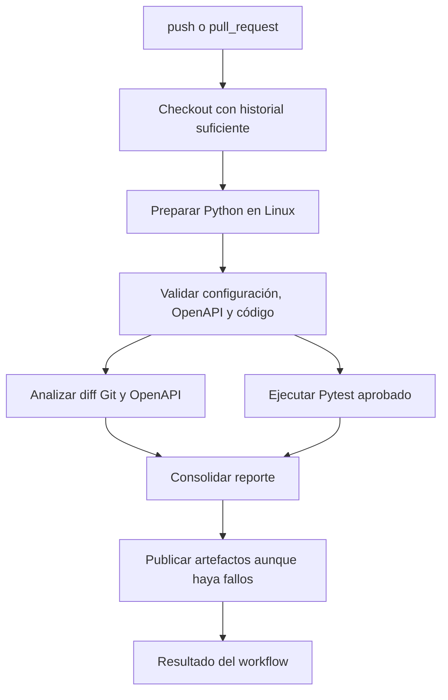

# 04. Diseño del pipeline de CI

## 1. Objetivo

El pipeline valida los cambios de un repositorio de API y ejecuta en Linux las pruebas Pytest aprobadas que forman parte de la revisión. Debe proporcionar evidencia y reportes en cada commit o Pull Request, con credenciales y permisos mínimos. Un workflow manual separado permite generar candidatos con Gemini a partir de un diff elegido, manteniendo la revisión humana antes de producir pruebas ejecutables.

La generación no se dispara automáticamente en cada Pull Request: evita gasto no previsto y el uso de secrets en contextos no confiables. Una persona inicia `workflow_dispatch` desde el workflow de la rama predeterminada de confianza y proporciona las revisiones a comparar. El workflow solo procesa el diff como datos: no hace checkout ni ejecuta código de la revisión destino. Los candidatos se descargan como artefacto, se revisan en la interfaz y, después de la aprobación, las pruebas generadas se incorporan al repositorio. Los workflows automáticos ejecutan esas pruebas versionadas en `push`/`pull_request`.

## 2. Disparadores

- **`push`:** commits en las ramas configuradas para desarrollo e integración, como la rama principal y ramas de trabajo seleccionadas.
- **`pull_request`:** apertura, sincronización y reapertura de Pull Requests dirigidos a las ramas configuradas.
- **`workflow_dispatch`:** ejecución manual desde la rama predeterminada para solicitar generación de casos candidatos. La ejecución requiere el secret configurado y un contexto de confianza; se describen las condiciones en la sección 3.1.

Los filtros de ramas y rutas se mantendrán explícitos y se ajustarán al flujo real del repositorio.

## 3. Flujo de jobs

### Job 1: Validación y preparación

- Ejecuta en un runner Linux.
- Descarga el repositorio y las revisiones necesarias para calcular el diff; obtiene historial suficiente, sin depender de un clon superficial que omita la revisión base.
- Configura una versión de Python fijada por el proyecto y restaura/instala las dependencias desde el manifiesto versionado.
- Ejecuta verificaciones de formato, configuración y validez de la especificación OpenAPI incorporadas por los hitos de implementación.
- Falla de manera visible ante contrato inválido o error de validación.

### Job 2: Análisis de impacto

- Determina el par de revisiones a comparar de acuerdo con el evento: base y head del Pull Request; para `push`, el commit anterior disponible y el commit nuevo, informando si la revisión anterior no existe.
- Ejecuta el detector Git y el comparador OpenAPI.
- Produce un resumen de archivos, operaciones y cambios de contrato, con la evidencia y las limitaciones de correlación.
- No llama a Gemini ni necesita `GEMINI_API_KEY`.
- Sube el resumen como artefacto. Un cambio OpenAPI que no pueda interpretarse debe generar un diagnóstico explícito y un estado fallido de validación, no un análisis aparentemente vacío.

### Job 3: Pruebas aprobadas

- Ejecuta con Pytest las pruebas disponibles en el commit del workflow, incluidas las pruebas aprobadas generadas y versionadas.
- Las pruebas de la API FastAPI de ejemplo importan su fábrica de aplicación y usan `fastapi.testclient.TestClient` en proceso; no se inicia Uvicorn ni se expone un puerto en CI. Las dependencias y el entorno de pruebas se instalan antes de invocar Pytest.
- No genera pruebas desde propuestas pendientes ni modifica decisiones humanas.
- Emite resultados estructurados (por ejemplo, JUnit XML) y cobertura cuando esté habilitada.
- Devuelve un estado fallido si alguna prueba falla. Solo los resultados reales de Pytest alimentan Estado `Exitoso` o `Fallido`; los casos que no se ejecutan siguen `No ejecutado`.

### Job 4: Reporte y artefactos

- Se ejecuta incluso si falla el análisis o la suite de pruebas, para conservar los diagnósticos y resultados disponibles.
- Publica los reportes de Pytest, cobertura (si está configurada), análisis de impacto, logs redactados y resumen de métricas.
- Usa nombres de artefacto que identifiquen la revisión y el intento de workflow; aplica una política de retención finita.
- No presenta una ejecución incompleta como exitosa. El estado global del workflow refleja el fallo de los jobs requeridos.

Los jobs podrán combinarse o separarse según las dependencias y tiempos medidos durante la implementación, pero el análisis, las pruebas y la publicación de resultados deben conservar estas responsabilidades y condiciones de fallo.

### Workflow manual: generación de candidatos (`workflow_dispatch`)

Este flujo es separado del workflow automático y no ejecuta pruebas candidatas:

1. Una persona inicia el workflow con la referencia base y el SHA de destino de una rama del mismo repositorio. Los valores se validan como referencias Git resolubles.
2. El job solo se habilita cuando la referencia del propio workflow es la rama predeterminada (`github.ref == refs/heads/<default_branch>`). El workflow se obtiene y ejecuta desde esa rama de confianza.
3. El job obtiene el diff Git y las especificaciones OpenAPI indicadas, pero **no hace checkout, importa ni ejecuta el código del SHA destino**. Solo procesa el diff como entrada de datos.
4. Antes de construir el contexto, usa una lista permitida de archivos y fragmentos relevantes, excluye `.env`, archivos de secretos, credenciales, claves privadas, archivos binarios y rutas de datos que no deban enviarse al proveedor, y aplica detección/redacción de patrones de secretos en el contenido seleccionado. Si hay una coincidencia no resuelta, detiene la generación y no envía ese contexto. La clave de Gemini nunca forma parte del prompt.
5. Usa `GEMINI_API_KEY` desde GitHub Secrets, un environment protegido y permisos de solo lectura (`contents: read`). No imprime la clave ni las cabeceras de autenticación; limita concurrencia y retención del artefacto.
6. Valida la respuesta y sube un JSON/CSV de **candidatos no aprobados** con metadatos no sensibles. El artefacto no contiene claves, no se convierte en Pytest y no se ejecuta en este workflow.
7. El desarrollador descarga el artefacto, revisa y modifica los casos en la interfaz local, aprueba o rechaza cada uno y genera Pytest solo para los aprobados. Tras versionar las pruebas aprobadas, `push` o `pull_request` activa el flujo automático de prueba.

El job de generación debe fallar si la condición de rama confiable no se cumple, falta el secret, una referencia no se resuelve, el diff excede los límites o la respuesta no pasa la validación. Los fallos no deben producir un artefacto que aparente éxito. Los archivos omitidos y el alcance exacto del diff se registran en el resumen para que la persona revisora conozca el contexto utilizado.

La rama predeterminada se determina desde la configuración del repositorio, no se codifica como `main`. El workflow no utiliza `pull_request_target`; una referencia de Pull Request no confiable es solo contenido de diff y nunca código ejecutable. La persona responsable debe verificar que el cambio de la rama predeterminada que define el workflow es confiable antes de autorizar su ejecución y el uso del secret.

## 4. Uso de secretos y permisos

- La ejecución normal de análisis y pruebas **no requiere** `GEMINI_API_KEY`.
- La clave se almacena como GitHub Secret con alcance mínimo y nunca se escribe en el repositorio, logs, reportes, cachés ni artefactos.
- No se utilizará `pull_request_target` para hacer checkout y ejecutar código de un Pull Request.
- Los Pull Requests provenientes de forks se ejecutarán sin secrets; no se intentará obtener la clave desde una rama no confiable.
- El único uso de `GEMINI_API_KEY` en CI es el job manual `workflow_dispatch`, condicionado a la rama predeterminada y a un environment protegido. El flujo automático de `push`/`pull_request` nunca recibe la clave.
- El workflow declarará los permisos mínimos necesarios (por defecto, solo lectura del contenido) y no concederá escritura de tokens, permisos administrativos o publicación de comentarios si no son necesarios.
- Las acciones de terceros se fijarán a versiones verificadas y, al implementar el workflow, se preferirán referencias inmutables por SHA.
- El contenido de un caso, nombre de rama, salida del LLM y log de prueba se considera entrada no confiable; no se interpolará directamente como código de shell ni se ejecutará como configuración del workflow.

## 5. Artefactos y reporte

El conjunto de artefactos debe permitir responder:

- ¿Qué revisión y evento se analizaron?
- ¿Qué archivos, operaciones OpenAPI y restricciones cambiaron?
- ¿Qué casos aprobados se ejecutaron y cuál fue el resultado real de cada uno?
- ¿Qué pruebas fallaron y cuáles no se ejecutaron?
- ¿Qué cobertura y métricas se obtuvieron, con qué denominadores?

Los artefactos podrán incluir:

1. Resultado JUnit de Pytest.
2. Reporte de cobertura, si se ejecutó y configuró.
3. Resumen JSON/Markdown del impacto Git/OpenAPI.
4. Reporte tabular de casos, RF del SUT, módulo, Estado y Automatizado, sin secretos.
5. Logs necesarios para diagnóstico, sujetos a redacción y retención limitada.

La hoja Excel editable es principalmente un artefacto de revisión local/versionado; CI no debe sobrescribir las decisiones humanas. Un reporte de CI es una salida de ejecución, no sustituye el catálogo revisado ni la trazabilidad fuente.

## 6. Fallos y condiciones de éxito

El workflow falla si una verificación requerida, la validación del contrato, el análisis requerido o una prueba Pytest falla. La falta de una revisión base puede limitar el diff de un primer `push`; el job lo reporta como tal y aplica la política configurada sin inventar cambios. Un fallo de infraestructura se distingue de un fallo de aserción, pero no se presenta como aprobación.

La publicación del artefacto debe intentarse aun cuando fallen los jobs anteriores. Si la publicación también falla, esa condición queda explícita en el resultado. No se asigna `Exitoso` a casos sin ejecución, a ejecuciones omitidas ni a flujos con error de configuración.

## 7. Configuración inicial y protección de ramas

Antes de habilitar protección de ramas, se identificará el nombre del job requerido y se configurarán reglas para exigir el workflow en Pull Requests. Las versiones de Python y dependencias se mantendrán reproducibles según las decisiones de implementación. La presencia de `GEMINI_API_KEY` no será un requisito para pasar la CI de pruebas aprobadas; la generación de nuevos casos se gestiona fuera del camino de ejecución ordinario.

## 8. Correspondencia con el flujo de la herramienta

El flujo general es:

**Commit / Pull Request → detección de cambios Git y OpenAPI → análisis de impacto → workflow manual de generación Gemini en contexto confiable → revisión/aprobación humana → generación y versionado de Pytest → ejecución automática en CI → reporte.**

CI automatiza la detección, validación, ejecución y publicación de resultados. La generación es manual y aislada para acotar el uso del secret; la decisión de aprobar sigue siendo humana para evitar que una propuesta no revisada se convierta en código ejecutable. En la API de ejemplo, la ejecución en CI usa `TestClient` en proceso y no depende de iniciar un servidor Uvicorn.
